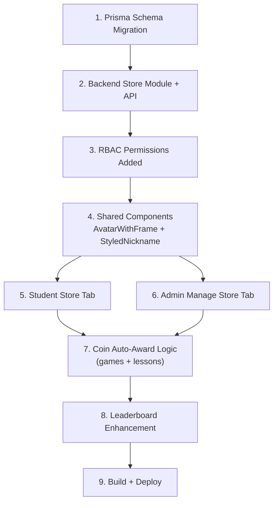

# 🏪 Engrew Gamification Store — Full Technical Plan

> **Status**: Planning Only — No implementation started  
> **Author**: AI Architect  
> **Date**: 2026-11-24  
> **Scope**: Backend schema, API, frontend tabs (Student Store + Admin Manage Store), RBAC, coin economy, avatar/nickname system, transaction history, notifications

---

## Table of Contents

1. [Feature Overview](#1-feature-overview)
2. [Coin Economy Design](#2-coin-economy-design)
3. [Database Schema (Prisma)](#3-database-schema-prisma)
4. [Backend API — New `store` Module](#4-backend-api--new-store-module)
5. [RBAC Permissions](#5-rbac-permissions)
6. [Frontend — Student Store Tab](#6-frontend--student-store-tab)
7. [Frontend — Admin Manage Store Tab](#7-frontend--admin-manage-store-tab)
8. [Avatar Frame & Nickname Display System](#8-avatar-frame--nickname-display-system)
9. [Leaderboard Enhancement](#9-leaderboard-enhancement)
10. [Notifications](#10-notifications)
11. [Migration & Deployment Plan](#11-migration--deployment-plan)
12. [Implementation Order](#12-implementation-order)

---

## 1. Feature Overview

### Core Concept

The Gamification Store lets students spend **Coins** (a separate spendable currency) to purchase cosmetic items:
- **Avatar Frames** — decorative borders around the student's profile picture
- **Nicknames** — styled display names with colors, glows, fonts, and badge icons

### Two-Currency System

| Currency | Purpose | Ever Deducted? | Earned By |
|---|---|---|---|
| **Points** | Leaderboard rank, season scoring | ❌ Never | Completing games, lessons, homework |
| **Coins** | Spending in the Store | ✅ On redemption | Automatically from points milestone OR admin grant |

> [!IMPORTANT]
> Points are **never** deducted. Only coins are spent. This preserves leaderboard integrity while enabling a spending economy.

### Roles Involved

| Role | Store Access |
|---|---|
| `STUDENT` | Browse store, redeem items, equip items, view own coin balance + history |
| `TEACHER` | View-only: student's equipped frame/nickname in lesson view |
| `ADMIN` / `SUPER_ADMIN` | Full store management: create/edit/delete items, grant/deduct coins, view all transactions |
| `CS` (Customer Support) | View-only coin transaction audit log |
| `SALES` | No store access |

---

## 2. Coin Economy Design

### Earning Coins

Coins are awarded automatically whenever a student's `totalPoints` crosses a threshold:

```
Every 100 points earned → 10 coins awarded
```

**Implementation**: In `games.service.ts` and `lessons.service.ts`, after incrementing `totalPoints`, compute:

```typescript
const previousCoins = Math.floor(previousPoints / 100) * 10;
const newCoins = Math.floor(newPoints / 100) * 10;
const coinsToAward = newCoins - previousCoins;

if (coinsToAward > 0) {
  await prisma.student.update({ where: { id }, data: { coins: { increment: coinsToAward } } });
  await prisma.coinTransaction.create({
    data: {
      studentId: id,
      amount: coinsToAward,
      coinsAfter: student.coins + coinsToAward,
      type: 'EARNED_FROM_POINTS',
      description: `Earned ${coinsToAward} coins for reaching ${newPoints} total points`,
    }
  });
}
```

### Spending Coins

When a student redeems a store item:
1. Check `student.coins >= item.coinCost`
2. Deduct `item.coinCost` from `student.coins`
3. Create `StudentStoreItem` record (inventory entry)
4. Create negative `CoinTransaction` (`amount = -item.coinCost`)
5. Send notification to student

### Admin Manual Operations

Admins can grant or deduct coins from any student via the Admin Store panel (with a required reason field for auditability).

### Rarity & Pricing Guidelines

| Rarity | Coin Cost Range | Visual Prestige |
|---|---|---|
| `COMMON` | 50–150 coins | Simple solid border or basic color |
| `RARE` | 200–400 coins | Gradient or animated frame |
| `EPIC` | 500–800 coins | Glowing or particle frame, rare font |
| `LEGENDARY` | 1000–2000 coins | Full animated + badge icon + special effect |

---

## 3. Database Schema (Prisma)

### 3.1 — Additions to `Student` Model

```prisma
model Student {
  // ... existing fields ...

  // NEW FIELDS
  coins                  Int                @default(0)
  equippedAvatarFrameId  String?
  equippedNicknameId     String?

  // NEW RELATIONS
  equippedAvatarFrame    StoreItem?         @relation("EquippedFrame", fields: [equippedAvatarFrameId], references: [id])
  equippedNickname       StoreItem?         @relation("EquippedNickname", fields: [equippedNicknameId], references: [id])
  coinTransactions       CoinTransaction[]
  storeInventory         StudentStoreItem[]
}
```

### 3.2 — New Enums

```prisma
enum StoreItemType {
  AVATAR_FRAME
  NICKNAME
}

enum StoreItemRarity {
  COMMON
  RARE
  EPIC
  LEGENDARY
}

enum CoinTransactionType {
  EARNED_FROM_POINTS
  REDEEMED_ITEM
  ADMIN_GRANT
  ADMIN_DEDUCT
}
```

Add to existing `PointsEventType`:
```prisma
enum PointsEventType {
  // ... existing ...
  COIN_EARNED
  ITEM_REDEEMED
}
```

### 3.3 — `StoreItem` Model

```prisma
model StoreItem {
  id          String          @id @default(uuid())
  type        StoreItemType
  rarity      StoreItemRarity @default(COMMON)
  isActive    Boolean         @default(true)
  sortOrder   Int             @default(0)
  coinCost    Int

  // Multilingual names
  nameEn      String
  nameHe      String
  nameAr      String
  descEn      String?
  descHe      String?
  descAr      String?

  // Avatar Frame fields (populated when type = AVATAR_FRAME)
  frameImageUrl     String?
  frameAnimated     Boolean  @default(false)
  frameCssClass     String?   // e.g. "frame-gold-glow"
  frameBorderColor  String?   // hex
  frameBorderRadius String?   // e.g. "50%"

  // Nickname fields (populated when type = NICKNAME)
  nicknameColor      String?  // hex or CSS gradient
  nicknameGlow       Boolean  @default(false)
  nicknameGlowColor  String?
  nicknameFont       String?  // e.g. "font-bold", "font-mono"
  nicknameBadgeIcon  String?  // emoji or icon key
  nicknameCssClass   String?  // combined tailwind/custom class

  createdAt   DateTime  @default(now())
  updatedAt   DateTime  @updatedAt
  createdById String?

  // Relations
  createdBy   User?              @relation(fields: [createdById], references: [id])
  redemptions StudentStoreItem[]

  // Reverse relations for equipped
  equippedAsFrameBy   Student[] @relation("EquippedFrame")
  equippedAsNicknameBy Student[] @relation("EquippedNickname")

  @@map("store_items")
}
```

### 3.4 — `StudentStoreItem` Model (Inventory)

```prisma
model StudentStoreItem {
  id          String    @id @default(uuid())
  studentId   String
  storeItemId String
  redeemedAt  DateTime  @default(now())
  isEquipped  Boolean   @default(false)

  student     Student   @relation(fields: [studentId], references: [id])
  storeItem   StoreItem @relation(fields: [storeItemId], references: [id])

  @@unique([studentId, storeItemId])  // Cannot buy same item twice
  @@map("student_store_items")
}
```

### 3.5 — `CoinTransaction` Model

```prisma
model CoinTransaction {
  id          String              @id @default(uuid())
  studentId   String
  amount      Int                 // positive = earned, negative = spent
  coinsAfter  Int                 // snapshot of balance after this tx
  type        CoinTransactionType
  referenceId String?             // storeItemId when REDEEMED_ITEM
  description String?
  createdAt   DateTime            @default(now())

  student     Student   @relation(fields: [studentId], references: [id])
  storeItem   StoreItem? @relation(fields: [referenceId], references: [id])

  @@index([studentId])
  @@index([createdAt])
  @@map("coin_transactions")
}
```

> [!NOTE]
> `coinsAfter` is a snapshot field — it records the balance after each transaction so the history is fully auditable without recalculating.

---

## 4. Backend API — New `store` Module

### Module Structure

```
backend/src/modules/store/
├── store.module.ts
├── store.controller.ts
├── store.service.ts
├── dto/
│   ├── create-store-item.dto.ts
│   ├── update-store-item.dto.ts
│   ├── redeem-item.dto.ts
│   ├── equip-item.dto.ts
│   └── grant-coins.dto.ts
└── store.types.ts
```

### 4.1 — Public / Student Endpoints

| Method | Path | Auth | Description |
|---|---|---|---|
| `GET` | `/api/v1/store/items` | Any logged-in | List all active items (filter: `type`, `rarity`, `maxCost`) |
| `GET` | `/api/v1/store/items/:id` | Any logged-in | Single item detail |
| `GET` | `/api/v1/store/my-coins` | STUDENT | Coin balance + recent 20 transactions |
| `GET` | `/api/v1/store/my-inventory` | STUDENT | All redeemed items with `isEquipped` state |
| `POST` | `/api/v1/store/redeem` | STUDENT | Redeem item by `storeItemId` |
| `POST` | `/api/v1/store/equip` | STUDENT | Equip/unequip an owned item |

#### `POST /api/v1/store/redeem` — Logic

```typescript
async redeemItem(studentId: string, storeItemId: string) {
  return await this.prisma.$transaction(async (tx) => {
    const student = await tx.student.findUnique({ where: { id: studentId } });
    const item = await tx.storeItem.findUnique({ where: { id: storeItemId } });

    if (!item || !item.isActive) throw new NotFoundException('Item not found');
    if (student.coins < item.coinCost) throw new BadRequestException('Insufficient coins');

    // Check not already owned
    const existing = await tx.studentStoreItem.findUnique({
      where: { studentId_storeItemId: { studentId, storeItemId } }
    });
    if (existing) throw new ConflictException('Item already owned');

    // Deduct coins
    const coinsAfter = student.coins - item.coinCost;
    await tx.student.update({
      where: { id: studentId },
      data: { coins: coinsAfter }
    });

    // Create inventory entry
    await tx.studentStoreItem.create({
      data: { studentId, storeItemId }
    });

    // Record transaction
    await tx.coinTransaction.create({
      data: {
        studentId,
        amount: -item.coinCost,
        coinsAfter,
        type: 'REDEEMED_ITEM',
        referenceId: storeItemId,
        description: `Redeemed: ${item.nameEn}`
      }
    });

    // Fire notification (async, non-blocking)
    this.notificationsService.sendToStudent(studentId, {
      title: '🎉 Redemption Successful!',
      body: `You redeemed "${item.nameEn}"! Coins remaining: ${coinsAfter}`
    });

    return { success: true, coinsAfter, item };
  });
}
```

#### `POST /api/v1/store/equip` — Logic

```typescript
async equipItem(studentId: string, storeItemId: string, equip: boolean) {
  const owned = await this.prisma.studentStoreItem.findUnique({
    where: { studentId_storeItemId: { studentId, storeItemId } },
    include: { storeItem: true }
  });
  if (!owned) throw new ForbiddenException('Item not owned');

  const field = owned.storeItem.type === 'AVATAR_FRAME'
    ? 'equippedAvatarFrameId'
    : 'equippedNicknameId';

  await this.prisma.$transaction([
    // Unequip all same-type items first
    this.prisma.studentStoreItem.updateMany({
      where: { studentId, storeItem: { type: owned.storeItem.type } },
      data: { isEquipped: false }
    }),
    // Equip the selected one
    this.prisma.studentStoreItem.update({
      where: { studentId_storeItemId: { studentId, storeItemId } },
      data: { isEquipped: equip }
    }),
    // Update Student.equippedXxxId
    this.prisma.student.update({
      where: { id: studentId },
      data: { [field]: equip ? storeItemId : null }
    })
  ]);

  return { success: true };
}
```

### 4.2 — Admin Endpoints

| Method | Path | Permission | Description |
|---|---|---|---|
| `POST` | `/api/v1/store/items` | `store:manage_items` | Create new item |
| `PUT` | `/api/v1/store/items/:id` | `store:manage_items` | Update item |
| `DELETE` | `/api/v1/store/items/:id` | `store:manage_items` | Soft-delete (set `isActive = false`) |
| `POST` | `/api/v1/store/grant-coins` | `store:grant_coins` | Manually grant/deduct coins |
| `GET` | `/api/v1/store/transactions` | `store:view_transactions` | All coin transactions (paginated, filterable) |
| `GET` | `/api/v1/store/transactions/:studentId` | `store:view_transactions` | Specific student's transactions |

#### `POST /api/v1/store/grant-coins` Payload

```typescript
{
  studentId: string;
  amount: number;        // positive = grant, negative = deduct
  reason: string;        // required, stored in description
}
```

---

## 5. RBAC Permissions

### New Permission Codes

Add to `backend/src/modules/roles/permissions.ts`:

```typescript
// Store permissions
'store:view_items',       // Browse store (students, teachers, admins)
'store:redeem',           // Redeem items (students only)
'store:manage_items',     // CRUD store items (admin, super_admin)
'store:grant_coins',      // Manually grant/deduct coins (admin, super_admin)
'store:view_transactions',// View coin audit log (admin, super_admin, cs)
```

### Default Role Matrix (additions)

| Permission | SUPER_ADMIN | ADMIN | TEACHER | STUDENT | CS | SALES |
|---|---|---|---|---|---|---|
| `store:view_items` | ✅ | ✅ | ✅ | ✅ | ✅ | ❌ |
| `store:redeem` | ❌ | ❌ | ❌ | ✅ | ❌ | ❌ |
| `store:manage_items` | ✅ | ✅ | ❌ | ❌ | ❌ | ❌ |
| `store:grant_coins` | ✅ | ✅ | ❌ | ❌ | ❌ | ❌ |
| `store:view_transactions` | ✅ | ✅ | ❌ | ❌ | ✅ | ❌ |

### How to Add to Role Matrix UI

The existing `RolesMatrixTab` in admin already maps `permissions → roles`. Add the 5 new permissions to the `PERMISSION_GROUPS` constant under a new group: `"🏪 Gamification Store"`.

---

## 6. Frontend — Student Store Tab

### 6.1 — Tab Registration

**File**: `frontend/src/pages/StudentDashboard.tsx`

```typescript
// Add to tab type union:
type ActiveTab = 'overview' | 'booking' | ... | 'store';

// Add to tab nav items:
{
  id: 'store',
  label: { en: 'Store', he: 'חנות', ar: 'المتجر' },
  icon: <ShoppingBag size={18} />,
  badge: student?.coins ? `🪙 ${student.coins}` : undefined,
}
```

**URL param**: `?tab=store`

**Lazy load**: Wrap with `React.lazy` + `<Suspense>`:
```tsx
const StoreTab = React.lazy(() => import('../components/student/StoreTab'));
```

### 6.2 — `StoreTab.tsx` Component Structure

```
StoreTab
├── CoinBalanceHeader          — Animated coin counter, total earned, total spent
├── StoreFilters               — All | Avatar Frames | Nicknames | filter by Rarity
├── StoreItemGrid
│   └── StoreItemCard × N     — Preview, name, rarity badge, cost, Redeem / Owned button
├── MyInventorySection
│   ├── OwnedItemCard × N     — Preview + Equip/Unequip toggle
│   └── EmptyState            — "Your inventory is empty. Start collecting!"
├── CoinTransactionHistory     — Collapsible accordion, paginated
└── RedeemConfirmModal         — Custom modal (never browser alert)
```

### 6.3 — `StoreItemCard` Design

```
┌─────────────────────────────────┐
│  [EPIC]              🪙 500     │  ← rarity badge + cost
│                                 │
│    ┌───────────────────────┐    │
│    │  Live Preview         │    │  ← avatar with frame OR styled name
│    │  (AvatarWithFrame OR  │    │
│    │   StyledNickname)     │    │
│    └───────────────────────┘    │
│                                 │
│  Golden Flame Frame             │  ← localized name
│  הד הלהבה הזהוב                 │
│                                 │
│  [ 🪙 Redeem for 500 Coins ]   │  ← OR [ ✓ Owned · Equip ]
└─────────────────────────────────┘
```

**Rarity color mapping**:
- `COMMON` → gray badge
- `RARE` → blue badge
- `EPIC` → purple badge
- `LEGENDARY` → gold animated gradient badge

### 6.4 — Redeem Confirm Modal

```
┌──────────────────────────────────────────┐
│  🎁 Confirm Redemption                   │
│                                          │
│  You are about to redeem:                │
│  "Golden Flame Frame"                    │
│                                          │
│  Cost: 🪙 500 coins                      │
│  Your balance after: 🪙 150 coins        │
│                                          │
│  [ Cancel ]        [ Confirm Redeem ✓ ] │
└──────────────────────────────────────────┘
```

> [!WARNING]
> Never use browser `alert()` or `confirm()`. Always use this custom modal component.

### 6.5 — Coin Transaction History Row

```
🪙 +10 coins    Earned from reaching 100 points    2026-11-24   Balance: 60
🪙 -500 coins   Redeemed: Golden Flame Frame         2026-11-23   Balance: 50
🪙 +100 coins   Admin grant: Welcome bonus           2026-11-20   Balance: 550
```

Color: positive = green, negative = red.

### 6.6 — API Hooks (TanStack Query)

```typescript
// hooks/useStore.ts
export const useStoreItems = (filters?) => useQuery({ queryKey: ['store-items', filters], ... });
export const useMyCoins = () => useQuery({ queryKey: ['my-coins'], ... });
export const useMyInventory = () => useQuery({ queryKey: ['my-inventory'], ... });
export const useRedeemItem = () => useMutation({ mutationFn: redeemItem, onSuccess: () => {
  queryClient.invalidateQueries(['my-coins']);
  queryClient.invalidateQueries(['my-inventory']);
}});
export const useEquipItem = () => useMutation({ mutationFn: equipItem, onSuccess: () => {
  queryClient.invalidateQueries(['my-inventory']);
  queryClient.invalidateQueries(['student-profile']);
}});
```

---

## 7. Frontend — Admin Manage Store Tab

### 7.1 — Tab Registration

**File**: `frontend/src/components/admin/EnterpriseTabsContainer.tsx`

Add a new subtab `store_management` gated by `store:manage_items`:

```typescript
{
  id: 'store_management',
  label: { en: 'Manage Store', he: 'ניהול חנות', ar: 'إدارة المتجر' },
  icon: <ShoppingBag size={16} />,
  permission: 'store:manage_items',
}
```

### 7.2 — `StoreManagementTab.tsx` Structure

```
StoreManagementTab
├── Tabs: [ Items | Transactions | Grant Coins ]
│
├── ItemsPanel
│   ├── ItemsTable (sortable: name, type, rarity, cost, status)
│   │   └── Row actions: Edit | Deactivate | Delete
│   └── [ + Create Item ] → CreateItemModal
│
├── TransactionsPanel
│   ├── Filters: student search, type, date range
│   └── TransactionsTable (studentName, amount, type, item, date, balance after)
│
└── GrantCoinsPanel
    ├── StudentSearchInput (autocomplete by name/email)
    ├── AmountInput (positive = grant, negative = deduct)
    ├── ReasonInput (required)
    └── [ Submit ] button
```

### 7.3 — Create/Edit Item Modal

The modal has two sections based on `type` selection:

#### Common Fields (all types)

```
Type:        [ Avatar Frame ◉ ]  [ Nickname ○ ]
Rarity:      [ COMMON ▼ ]
Coin Cost:   [ 500 ]
Active:      [ ✅ ]
Sort Order:  [ 10 ]

Name (EN):   ____________
Name (HE):   ____________
Name (AR):   ____________
Desc (EN):   ____________ (optional)
```

#### Avatar Frame Fields

```
Frame Image URL:    [ https://... ] or [ Upload ↑ ]
Frame CSS Class:    [ frame-gold-glow ] (auto-generated preview below)
Animated:           [ ✅ ]
Border Color:       [ #FFD700 ] 🎨
Border Radius:      [ 50% ]

━━━━━━━━ Live Preview ━━━━━━━━
   ┌─────────────────────┐
   │  🔥 (animated gold  │
   │     frame around    │
   │     avatar circle)  │
   └─────────────────────┘
```

#### Nickname Fields

```
Text Color:    [ #9333ea ] 🎨
Glow Effect:   [ ✅ ]
Glow Color:    [ #9333ea ] 🎨
Font Weight:   [ Bold ▼ ]
Badge Icon:    [ 👑 ] (emoji picker)
CSS Class:     [ nickname-purple-glow ] (auto-generated)

━━━━━━━━ Live Preview ━━━━━━━━
   👑 Mostafa Gamal   ← styled with selected properties
```

> [!TIP]
> The CSS class field should be auto-generated from the visual builder controls but allow manual override for advanced custom CSS. Store CSS classes in a shared `store-items.css` file in the frontend.

### 7.4 — Transactions Table (Admin)

Columns:
- Student Name + Avatar
- Amount (colored +/-)
- Type (badge: Earned / Redeemed / Admin Grant / Admin Deduct)
- Item (if redeemed)
- Balance After
- Date
- Admin (if manual grant, who did it)

Export to CSV button for finance audit.

---

## 8. Avatar Frame & Nickname Display System

### 8.1 — `AvatarWithFrame.tsx` Component

```tsx
interface AvatarWithFrameProps {
  avatarUrl?: string;
  studentName: string;
  frameItem?: StoreItem | null;  // null = no frame equipped
  size?: 'sm' | 'md' | 'lg' | 'xl';
}

// Renders:
// - Base: rounded-full avatar image or initials fallback
// - Frame overlay: absolute positioned div with frameCssClass applied
// - If frameAnimated, apply CSS animation class
```

**Usage locations**:
- `StudentDashboard` header
- `LeaderboardCard`
- `LessonView` (teacher sees student's avatar)
- `StoreItemCard` preview
- `ProfilePage`

### 8.2 — `StyledNickname.tsx` Component

```tsx
interface StyledNicknameProps {
  name: string;
  nicknameItem?: StoreItem | null;
  truncate?: boolean;
}

// Renders:
// - If nicknameItem: applies nicknameColor, nicknameGlow, nicknameFont, nicknameCssClass
// - Prepends nicknameBadgeIcon emoji if set
// - Falls back to plain text if no item equipped
```

**Usage locations**:
- Leaderboard student name
- Dashboard header greeting
- Student profile view

### 8.3 — CSS Strategy

Create `frontend/src/styles/store-frames.css`:

```css
/* Avatar Frame Classes */
.frame-gold-glow {
  border: 3px solid #FFD700;
  box-shadow: 0 0 10px #FFD700, 0 0 20px #FFD700;
  border-radius: 50%;
}
.frame-gold-glow.animated {
  animation: frame-gold-pulse 2s ease-in-out infinite;
}
@keyframes frame-gold-pulse {
  0%, 100% { box-shadow: 0 0 10px #FFD700; }
  50%       { box-shadow: 0 0 25px #FFD700, 0 0 40px #FFA500; }
}

/* Nickname Classes */
.nickname-purple-glow {
  color: #9333ea;
  text-shadow: 0 0 8px #9333ea;
  font-weight: bold;
}
.nickname-gold-legendary {
  background: linear-gradient(90deg, #FFD700, #FFA500, #FFD700);
  -webkit-background-clip: text;
  -webkit-text-fill-color: transparent;
  animation: shimmer 3s linear infinite;
}
```

> [!NOTE]
> New frame/nickname CSS classes must be added to this file whenever admin creates a new item with a new CSS class. The admin form should provide a list of existing CSS classes OR allow defining them (advanced feature for v2).

---

## 9. Leaderboard Enhancement

### Changes to `LeaderboardTab.tsx`

Replace plain avatar + name with:

```tsx
<div className="flex items-center gap-3">
  <AvatarWithFrame
    avatarUrl={student.avatarUrl}
    studentName={student.name}
    frameItem={student.equippedAvatarFrame}
    size="md"
  />
  <div>
    <StyledNickname
      name={student.name}
      nicknameItem={student.equippedNickname}
    />
    <p className="text-sm text-gray-500">{student.totalPoints} pts</p>
  </div>
</div>
```

### Backend Change

Include equipped items in leaderboard API response:

```typescript
// In leaderboard query, add:
include: {
  equippedAvatarFrame: true,
  equippedNickname: true,
}
```

---

## 10. Notifications

### On Successful Redemption

Send an in-platform notification to the student:

```typescript
await this.notificationsService.create({
  userId: student.userId,
  type: 'STORE_REDEMPTION',
  titleEn: '🎉 Redemption Successful!',
  titleHe: '🎉 המימוש הצליח!',
  titleAr: '🎉 تم الاسترداد بنجاح!',
  bodyEn: `You redeemed "${item.nameEn}"! Coins remaining: ${coinsAfter}`,
  bodyHe: `מימשת את "${item.nameHe}"! מטבעות שנותרו: ${coinsAfter}`,
  bodyAr: `قمت باسترداد "${item.nameAr}"! العملات المتبقية: ${coinsAfter}`,
});
```

### On Coin Grant by Admin

```
"💰 You received 100 coins from an admin. Reason: Welcome bonus!"
```

---

## 11. Migration & Deployment Plan

### Step 1: Prisma Schema Migration

```bash
# Add new models + fields to schema.prisma
# Then:
cd backend
npx prisma migrate dev --name add_gamification_store
```

**New migration includes**:
- `coins`, `equippedAvatarFrameId`, `equippedNicknameId` on `Student`
- `store_items` table
- `student_store_items` table
- `coin_transactions` table
- New enum values

### Step 2: Backend Module

1. Create `backend/src/modules/store/` directory and all files
2. Register `StoreModule` in `app.module.ts`
3. Add permission constants to `permissions.ts`
4. Seed initial store items (optional: a few starter frames/nicknames)

### Step 3: Frontend — Shared Components

1. Create `AvatarWithFrame.tsx`
2. Create `StyledNickname.tsx`
3. Add `store-frames.css` and import in `main.tsx`
4. Add store API hooks to `hooks/useStore.ts`

### Step 4: Frontend — Student Store Tab

1. Create `StoreTab.tsx`
2. Register tab in `StudentDashboard.tsx`
3. Add coin balance to tab badge

### Step 5: Frontend — Admin Store Tab

1. Create `StoreManagementTab.tsx`
2. Register in `EnterpriseTabsContainer.tsx` with permission gate
3. Add `store:manage_items` to roles matrix UI

### Step 6: Leaderboard Update

1. Update leaderboard query to include equipped items
2. Replace leaderboard card avatar/name rendering

### Step 7: Coin Auto-Award

1. Update `games.service.ts` to call `awardCoinsForPoints()` after every point award
2. Update `lessons.service.ts` similarly
3. Add `awardCoinsForPoints()` as a shared helper in `store.service.ts`

### Step 8: Build & Deploy

```bash
# Backend
cd backend && git add . && git commit -m "feat: add gamification store (schema + API)"
git push  # Vercel auto-deploys

# Frontend
cd frontend && npm run build
# FTP deploy dist/ → 88.99.162.137 (engrew cPanel)
```

---

## 12. Implementation Order



### Estimated Effort

| Phase | Estimated Sessions |
|---|---|
| Schema + Migration | 1 session |
| Backend Store Module | 2 sessions |
| Shared display components | 1 session |
| Student Store Tab | 2 sessions |
| Admin Manage Store | 2 sessions |
| Coin auto-award logic | 1 session |
| Leaderboard update | 0.5 session |
| Testing + polish | 1 session |
| **Total** | **~10-11 sessions** |

---

## Appendix: File Locations Reference

| File | Purpose |
|---|---|
| `backend/prisma/schema.prisma` | Add `StoreItem`, `StudentStoreItem`, `CoinTransaction`, Student fields |
| `backend/src/modules/store/store.module.ts` | NestJS module |
| `backend/src/modules/store/store.controller.ts` | Route handlers |
| `backend/src/modules/store/store.service.ts` | Business logic |
| `backend/src/modules/roles/permissions.ts` | Add 5 new permission codes |
| `frontend/src/pages/StudentDashboard.tsx` | Add `store` tab |
| `frontend/src/components/student/StoreTab.tsx` | Student store UI |
| `frontend/src/components/admin/StoreManagementTab.tsx` | Admin store management |
| `frontend/src/components/admin/EnterpriseTabsContainer.tsx` | Register admin subtab |
| `frontend/src/components/common/AvatarWithFrame.tsx` | Reusable avatar + frame |
| `frontend/src/components/common/StyledNickname.tsx` | Reusable styled name |
| `frontend/src/styles/store-frames.css` | CSS for frames + nicknames |
| `frontend/src/hooks/useStore.ts` | TanStack Query hooks |
